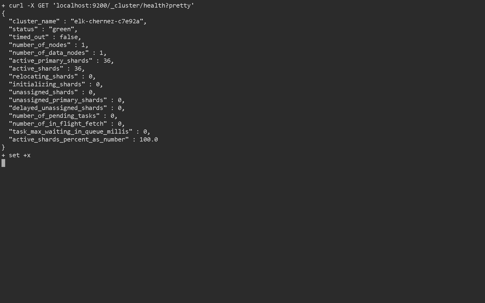
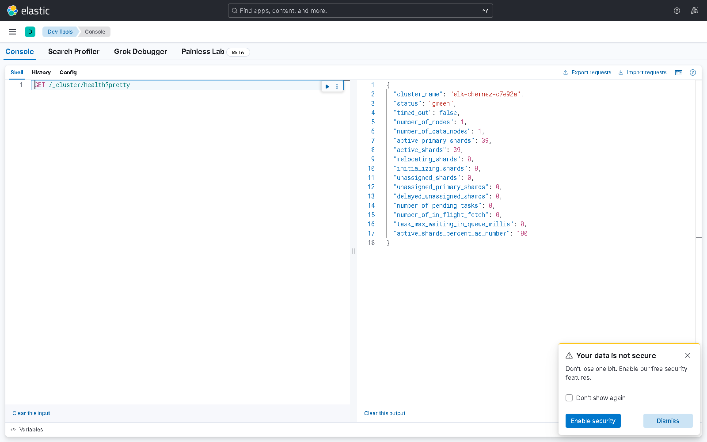
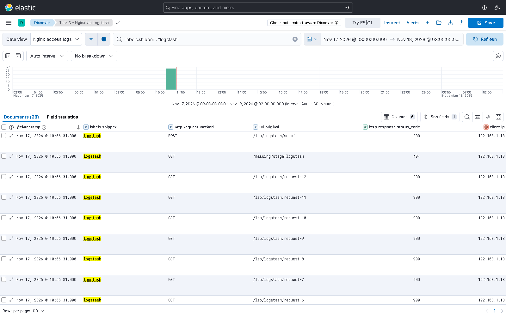
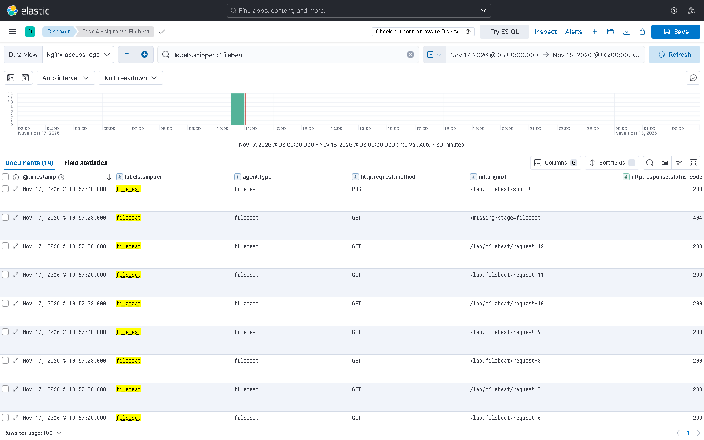

# Домашнее задание к занятию «ELK» — Чернецов Артём

Учебный стенд на сервере `192.168.1.13`: Ubuntu 24.04 LTS, 4 vCPU, 16 ГиБ RAM.
Elasticsearch, Kibana, Logstash и Filebeat: **8.19.6**; Nginx: **1.28.0**.
Развёртывание — Docker Compose, проект `elk-hw`, каталог сервера `~/elk-hw`.

> Это лабораторная конфигурация: аутентификация Elastic отключена. Elasticsearch опубликован только на `127.0.0.1:9200`, Kibana — на `192.168.1.13:5601`. Стенд предназначен для доверенной локальной сети.

## Файлы решения

- [compose.yaml](compose.yaml) — сервисы, отдельная сеть, постоянные тома и ограничения памяти.
- [elasticsearch/nginx-template.json](elasticsearch/nginx-template.json) — типы полей, один шард и ноль реплик для учебных индексов.
- [nginx/nginx.conf](nginx/nginx.conf) — запись access-лога в файл в формате JSON.
- [logstash/nginx.conf](logstash/nginx.conf) — чтение файла, разбор JSON и времени, отправка в Elasticsearch.
- [filebeat/filebeat.yml](filebeat/filebeat.yml) — чтение того же access-лога и прямая отправка в Elasticsearch.
- [scripts](scripts) — подготовка индексов и Kibana, генерация запросов, переключение и проверки.

## Задание 1. Elasticsearch

Elasticsearch запущен в Docker в режиме `single-node`. В Compose задан параметр:

```yaml
cluster.name: ${CLUSTER_NAME:-elk-chernez-c7e92a}
```

В конфигурации параметр называется `cluster.name`, а в ответе API — `cluster_name`.

Команда выполнена на сервере с Elasticsearch:

```bash
curl -X GET 'localhost:9200/_cluster/health?pretty'
```



## Задание 2. Kibana

Kibana подключена к `http://elasticsearch:9200` внутри сети Compose.
Открыта страница:

```text
http://192.168.1.13:5601/app/dev_tools#/console
```

В консоли выполнен запрос:

```http
GET /_cluster/health?pretty
```



## Задание 3. Logstash

Схема доставки:

```text
HTTP-запросы → Nginx → /var/log/nginx-lab/access.log → Logstash → Elasticsearch → Kibana
```

Nginx слушает порт `8088` и пишет JSON-строки в настоящий файл access-лога.
Том `nginx-access-logs` подключён к Logstash только для чтения.

Logstash использует `file` input, `json` codec и `date` filter. Время запроса становится
`@timestamp`. Разобранные поля включают `client.ip`, `http.request.method`,
`http.response.status_code`, `http.response.body.bytes` и `url.original`.
Для подтверждения маршрута добавлено `labels.shipper: logstash`.

Индекс: `nginx-logstash-YYYY.MM.dd`.
В Kibana создан Data View `nginx-*` с полем времени `@timestamp`.

Генерация и проверка:

```bash
bash scripts/02-generate-traffic.sh logstash
bash scripts/04-verify.sh logstash
```

В Discover выбран фильтр:

```text
labels.shipper : "logstash"
```

Проверено 28 событий после двух запусков генератора.



## Задание 4. Filebeat

Схема после переключения:

```text
HTTP-запросы → Nginx → /var/log/nginx-lab/access.log → Filebeat → Elasticsearch → Kibana
```

Перед переключением проверено поступление запросов задания 3. Затем Logstash остановлен.
Старый access-лог сохранён под именем `access.log.logstash-<timestamp>`; Nginx получил
сигнал переоткрытия файла. Filebeat читает только новый `access.log`, поэтому архив
задания 3 не отправляется повторно.

Filebeat использует `filestream` input и `ndjson` parser, преобразует время запроса
процессором `timestamp` и отправляет события **напрямую в Elasticsearch** через
`output.elasticsearch`. Метка маршрута — `labels.shipper: filebeat`.
Позиция чтения сохраняется в отдельном постоянном томе.

Индекс: `nginx-filebeat-YYYY.MM.dd`.

```bash
bash scripts/03-switch-to-filebeat.sh
bash scripts/04-verify.sh filebeat
```

В Discover выбран фильтр:

```text
labels.shipper : "filebeat"
```

На скриншоте также видно поле `agent.type: filebeat`, добавленное самим Filebeat.

Проверено 14 новых событий. В момент их доставки контейнер Logstash остановлен.



## Воспроизведение

Нужны Docker Engine, Docker Compose, `curl` и Python 3 для скрипта проверки.
Команды выполняются на Linux-сервере из корня репозитория.

1. Подготовить настройки:

   ```bash
   cp .env.example .env
   # При другом адресе сервера изменить SERVER_IP в .env.
   sysctl vm.max_map_count
   # Если значение ниже 1048576:
   # sudo sysctl -w vm.max_map_count=1048576
   ```

2. Запустить первый этап:

   ```bash
   docker compose --profile logstash up -d
   docker compose ps
   curl -X GET 'localhost:9200/_cluster/health?pretty'
   ```

3. Дождаться готовности Kibana на порту 5601, затем подготовить шаблон индексов и Data View:

   ```bash
   bash scripts/01-prepare.sh
   bash scripts/02-generate-traffic.sh logstash
   # Дождаться доставки событий, затем:
   bash scripts/04-verify.sh logstash
   ```

4. Проверить логи в Kibana Discover, затем переключить доставку:

   ```bash
   bash scripts/03-switch-to-filebeat.sh
   # Дождаться доставки событий, затем:
   bash scripts/04-verify.sh filebeat
   ```

5. Остановить стенд с сохранением данных:

   ```bash
   docker compose --profile logstash --profile filebeat stop
   ```

Скрипт генерации создаёт 14 реальных HTTP-запросов для каждого этапа:
12 GET с ответом 200, один GET с ответом 404 и один POST с ответом 200.
Скрипт проверки проверяет количество, разобранные поля, метку маршрута и отсутствие
ошибок разбора. Для одного узла у учебных индексов задано 0 реплик.

Не следует запускать оба профиля доставки одновременно: это приведёт к чтению одного
access-лога двумя отправителями.

## Результаты проверки и сохранённые представления

Проверки выполнены 17 ноября 2026 года. Полный вывод команд сохранён в
[evidence/verification.txt](evidence/verification.txt):

```text
PASS: 28 Nginx events via logstash; parsed timestamps, fields, GET/POST and 200/404 verified
PASS: 14 Nginx events via filebeat; parsed timestamps, fields, GET/POST and 200/404 verified
```

Кластер и оба учебных индекса имеют статус `green`. Проверки `nginx -t`,
`filebeat test config --strict.perms=false` и `filebeat test output --strict.perms=false`
прошли успешно. После выполнения задания 4 работают Elasticsearch, Kibana, Nginx и
Filebeat; Logstash остановлен. На корневом диске осталось около 15 ГиБ.

На исходной ВМ сохранены представления с фиксированным временем проверки:

- [Задание 3 — Nginx через Logstash](http://192.168.1.13:5601/app/discover#/view/a14d3f3f-6eb6-44e4-b7b1-84bb2fb6015f).
- [Задание 4 — Nginx через Filebeat](http://192.168.1.13:5601/app/discover#/view/b784f5e2-ad0b-44d0-86f1-fdd8c7331d94).

Экспорт представлений и Data View находится в [kibana/saved-objects.ndjson](kibana/saved-objects.ndjson).
Его можно импортировать через Kibana → Stack Management → Saved Objects → Import.
Экспорт содержит настройки представлений; сами события хранятся в томе Elasticsearch.
Для новых запросов после даты проверки нужно изменить диапазон времени в Discover.

## Подробный ход выполнения лабораторной

Стенд развёрнут на Ubuntu-сервере `192.168.1.13` в каталоге `~/elk-hw`. Команды ниже
приведены в порядке выполнения на сервере. Параметры SSH и пароль в отчёт не включены.

### 1. Подготовка и запуск Elasticsearch с Kibana

```bash
cd ~/elk-hw
cp .env.example .env
sysctl vm.max_map_count
docker compose --profile logstash up -d
docker compose ps
curl -X GET 'localhost:9200/_cluster/health?pretty'
```

`cd` выбирает каталог проекта, а копия `.env` задаёт версии компонентов, имя кластера
и адрес интерфейса Kibana. `vm.max_map_count` проверяет лимит memory map, необходимый
Elasticsearch. Compose запускает Elasticsearch, Kibana, Nginx и Logstash; профиль
`logstash` включает первый способ доставки. `docker compose ps` показывает состояние
сервисов. Запрос `curl` проверяет доступность API и подтверждает заданное имя
`elk-chernez-c7e92a` и состояние кластера.

### 2. Подготовка индексов и проверка Logstash

```bash
bash scripts/01-prepare.sh
bash scripts/02-generate-traffic.sh logstash
bash scripts/04-verify.sh logstash
```

Первый скрипт загружает шаблон индексов с одним шардом и без реплик (для односерверной
лабы), затем создаёт в Kibana Data View `nginx-*` с временным полем `@timestamp`.
Второй отправляет через Nginx 12 GET-запросов с ответом 200, один GET с ответом 404
и один POST с ответом 200. Nginx записывает их в JSON-файл; Logstash читает файл,
разбирает JSON и время, затем отправляет документы в Elasticsearch.
Проверочный скрипт обновляет индекс и проверяет число событий, разобранные поля,
HTTP-методы, статусы, временные отметки и метку `labels.shipper: logstash`.
После первой генерации проверка подтвердила 14 записей; после повторного запуска — 28.

В Kibana Discover выбран фильтр `labels.shipper : "logstash"`. Сохранённый поиск
«Task 3 - Nginx via Logstash» и скриншот фиксируют результат.

### 3. Переключение доставки на Filebeat

```bash
bash scripts/03-switch-to-filebeat.sh
bash scripts/04-verify.sh filebeat
```

Скрипт переключения сначала останавливает Logstash, архивирует уже прочитанный access-
лог и просит Nginx открыть новый файл. Это предотвращает повторную отправку старых
строк. Затем запускается Filebeat: он читает новый файл, разбирает JSON, приводит
время к `@timestamp` и отправляет записи прямо в Elasticsearch. Генератор создаёт
новые запросы с меткой `filebeat`. Проверка подтверждает 14 событий, включая GET,
POST и ответ 404, а также корректность разобранных полей.

В Discover используется фильтр `labels.shipper : "filebeat"`; в событиях также видно
`agent.type: filebeat`. Сохранён поиск «Task 4 - Nginx via Filebeat» и скриншот.
На этом этапе Logstash остановлен, а Elasticsearch, Kibana, Nginx и Filebeat работают.

### 4. Дополнительная проверка состояния

```bash
docker compose --profile logstash --profile filebeat ps -a
docker compose exec -T nginx nginx -t
docker compose exec -T filebeat filebeat test config --strict.perms=false
docker compose exec -T filebeat filebeat test output --strict.perms=false
curl -fsS 'localhost:9200/_cat/indices/nginx*?v'
df -h /
```

`ps -a` показывает активные и остановленные контейнеры. `nginx -t` проверяет синтаксис
конфигурации веб-сервера. Проверки Filebeat подтверждают корректность настроек и
соединение с Elasticsearch. `_cat/indices` показывает количество документов и здоровье
индексов Logstash и Filebeat. `df -h /` проверяет оставшееся место на диске.

### 5. Публикация решения

Из локального каталога репозитория выполнены команды:

```bash
git add README.md .env.example .gitattributes .gitignore compose.yaml \
  elasticsearch evidence filebeat kibana logstash nginx scripts img
git diff --cached --check
git commit -m "Complete ELK homework tasks 1-4 with configs and screenshots"
git push origin main
```

`git add` включает README, конфигурации, экспорт сохранённых поисков, результаты
проверок и скриншоты. `git diff --cached --check` проверяет форматирование.
`git commit` сохраняет решение в истории, а `git push` публикует ветку `main` в GitHub.

## Документация

- [Elasticsearch в Docker](https://www.elastic.co/guide/en/elasticsearch/reference/8.19/docker.html).
- [Logstash: file input](https://www.elastic.co/guide/en/logstash/8.19/plugins-inputs-file.html).
- [Filebeat: filestream input](https://www.elastic.co/guide/en/beats/filebeat/8.19/filebeat-input-filestream.html).

Дополнительное задание 5* в это решение не включено.
